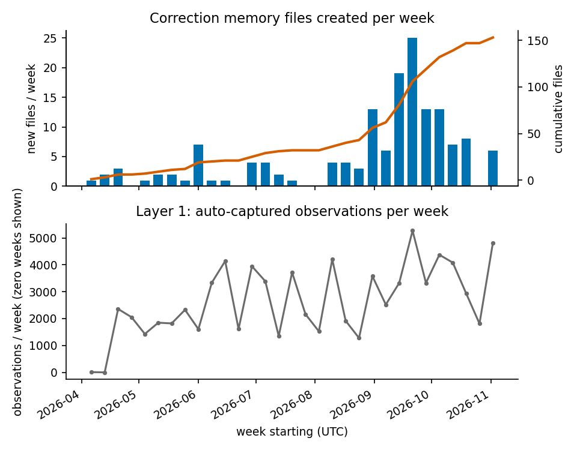
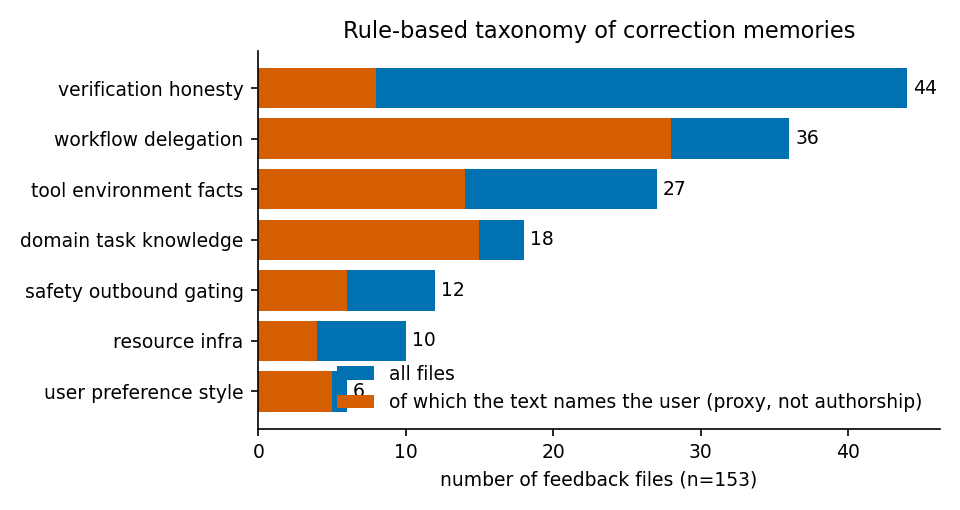
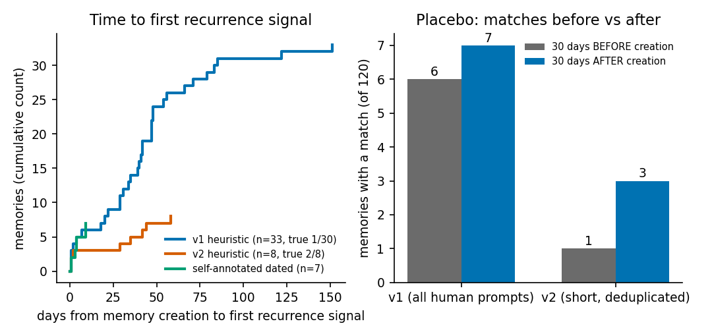
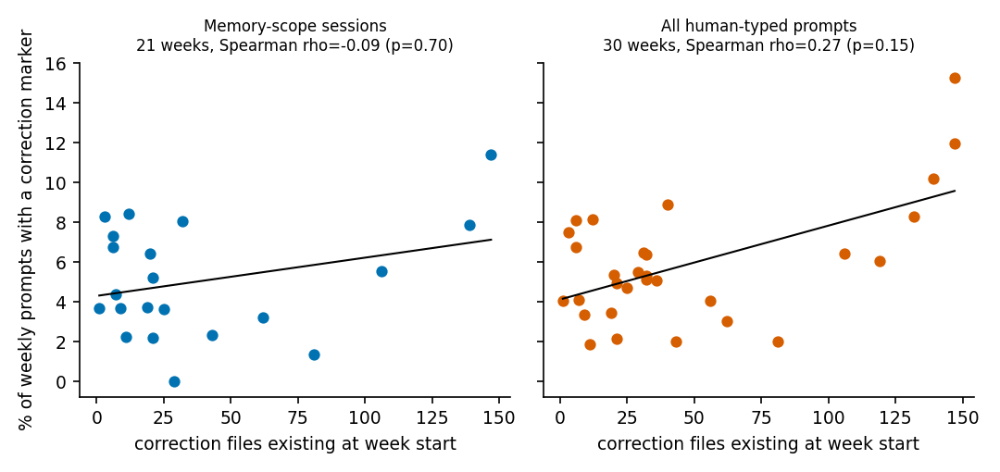

## Abstract

Coding agents are now given persistent memory so that a correction given once need not be given again. Whether this works in daily use is rarely measured. We report a seven-month observational field study of one developer's multi-agent coding setup that has two memory layers: 82,059 automatically captured observations and 153 explicit "feedback" files, each recording a correction (given by the developer or written by the agent after an incident). We ask how corrections accumulate, what they are about, how often they recur after being stored, and whether the developer's weekly correction rate changes as memory grows.

Corrections accumulated unevenly: 153 files in 31 calendar weeks, 71 of them (46.4%) in a single month. A transparent rule-based classifier put the largest groups in verification and honesty (44), workflow and delegation (36) and tool or environment facts (27); a 30-file hand check judged 22 assignments acceptable (73.3%, 95% Wilson interval 55.6 to 85.8). Recurrence is hard to measure. Memory files that annotate a later dated recurrence numbered 7 of 153 (4.6%, 2.2 to 9.1), the first one a median of 4 days after creation; this counts only what someone noticed and wrote down. Our prompt-matching heuristic, which flagged 33 of 152 eligible memories (21.7%), had a hand-checked precision of 1 in 30 (3.3%), and a before-versus-after placebo matched about as often in the 30 days before a memory existed as in the 30 days after (6 before versus 7 after, of 120). A refined second heuristic reached 2 of 8 true matches. The weekly share of prompts with correction markers showed no statistically significant association with memory size in this proxy, in sessions where the memory applies (Spearman rho = -0.09, p = 0.70, 21 weeks), and a positive association in an all-prompts sensitivity analysis, where the weekly rate also tracks median prompt length (rho = 0.54), which makes prompt composition a plausible but untested explanation. Re-read cost could not be measured because the database does not log retrievals. We conclude that these data can neither show that correction memories prevent repeated mistakes nor that they fail to. The defensible contribution is narrower: the observable recurrence signal is sparse (7 dated annotations among 153 files), simple prompt-matching detectors perform poorly (hand-checked precision 1 in 30), and memories would need machine-checkable triggers to be evaluable. All scripts are released; the underlying private data are not.

## 1 Introduction

A common complaint about coding agents is that they repeat mistakes: the same wrong tool, the same skipped check, the same unwanted behavior, session after session. The standard remedy is persistent memory. Some tools append a human-written instruction file to every session; others capture what the agent did and inject summaries later; many developers add a third, informal layer of short notes that record a correction and the reason for it.

The remedy rests on an untested premise, that a stored correction reduces the chance of the same mistake. Published agent-memory work evaluates on benchmarks, not on one working developer's repeated sessions. A developer who lives with an agent for months has a natural experiment of sorts: the corrections he or she gave, when each was written down, and what he or she said afterwards.

This paper reports such a study on one developer's data. It is deliberately modest. It is a single subject, it is observational, and the main outcome (recurrence of a mistake) is not directly recorded anywhere; we have to infer it. Our contribution is therefore as much about measurement as about results. We show what can and cannot be recovered from a typical local memory stack, we quantify how unreliable the obvious heuristic is by hand-checking it against a placebo, and we give the scripts so that other developers can run the same analysis on their own data.

We ask four research questions.

- **RQ1 (growth and taxonomy).** How do correction memories accumulate over time and what are they about?
- **RQ2 (recurrence).** What share of stored corrections recur afterwards, and how soon?
- **RQ3 (correction rate).** Does the weekly share of the developer's prompts that contain correction markers change as the memory grows?
- **RQ4 (retrieval economics).** What is the stored size of the memory versus the cost of reading it back?

## 2 Related work

Persistent memory for language-model agents is an active area. MemGPT [1] treats the context window as a limited resource and manages a hierarchy of memory tiers, moving information in and out of context, in analogy with operating-system virtual memory; the approach is continued in the open-source Letta project. Generative Agents [2] introduced a memory stream of natural-language observations scored for recency, importance and relevance, with periodic reflection that writes higher-level notes back into memory. Reflexion [3] stores verbal self-reflections on failed attempts in an episodic buffer that conditions the next attempt, and reports gains on coding, decision-making and reasoning tasks without weight updates. Voyager [4] accumulates an executable skill library for an embodied agent. Mem0 [5] describes a production memory layer that extracts, consolidates and retrieves salient facts from conversations and reports results on a conversational-memory benchmark.

These systems are evaluated on tasks that are designed and scored in advance. The question we ask is different and field-shaped: given a memory stack that a developer actually uses, do the corrections stored in it stop recurring? The closest conceptual neighbor is Reflexion, whose reflections are corrections to the agent's own failed trials. The difference is the time scale and the observer: the corrections here accumulate over months, are partly authored by the human, and are judged only by what the human later says. We know of no public field study of this kind and do not claim to have searched exhaustively.

## 3 System studied

The subject is a single professional data and AI engineer who works daily with terminal coding agents (mostly Claude Code, and to a lesser extent a second agent from another vendor) on many small projects, with several agents often running in parallel and with scheduled unattended agent jobs. Two memory layers are in use.

**Layer 1, automatic observations.** A local plugin stores a SQLite database. After tool calls, a background model writes short structured observations (a type, title, narrative, facts and concepts) tied to a session and project, and records the user's prompts. Summaries of recent observations are injected at the start of later sessions. At the snapshot used here the database held 82,059 observations from 2026-04-12 to 2026-11-07, 18,588 stored user prompts and 11,616 sessions (10,779 from the primary agent and 837 from the second). By type, 58.8% of observations are discoveries, 15.9% features, 12.3% bug fixes, 7.0% changes, 4.5% decisions, and the remaining 1.5% security notes, alerts and refactors.

**Layer 2, explicit correction files.** In the memory directory of the project in which most work is done, 384 Markdown files record durable knowledge. Of these 153 are "feedback" files: short notes, mostly with a date in the file name, that state a rule, the reason for it and how to apply it. A one-line index of the directory is loaded into the agent's context at the start of every session of that project. The index is 119 lines and 15,781 characters. Feedback files are of two kinds that we cannot always tell apart: instructions the developer gave and lessons the agent wrote after an incident, often a failed check or a misleading tool result. We did not verify authorship. As a crude proxy only, a text pattern finds the developer's alias mentioned in 80 of 153 files (52.3%); a mention can mean the developer gave the rule, or only that the note refers to him, so this proxy does not identify who supplied a correction.

The rest of the directory comprises 177 project notes, 46 reference notes and 8 other files, which we do not analyze.

## 4 Method

All numbers come from `analysis/analyze.py` run on a snapshot of the database taken on 2026-11-07 (rebuilt after a disk cleanup by re-copying the database and deleting rows newer than the original cutoff, 09:19 UTC; the SHA-256 digests of the input snapshot and memory directory are recorded in `results/aggregates.json`) (82,059 observations; the live database continues to grow, so counts in this paper can exceed counts seen earlier the same day). A second run on the same snapshot produced a byte-identical results file. Weeks start on Monday and use UTC.

### 4.1 Memory dates and taxonomy (RQ1)

A feedback file's creation date is the date in its file name when present (133 files), otherwise the first ISO date in its text (16), otherwise the file modification time (4). Weekly and monthly counts use that date.

Each file is assigned one category by a transparent, priority-ordered keyword scorer: a hit in the name or description counts 3, a hit in the body counts 1, the category with the highest score wins and ties go to the earlier category in the published list. The seven categories are safety and outbound gating, verification and honesty, tool and environment facts, resource and infrastructure, workflow and delegation, user preference and style, and domain task knowledge. The keyword lists are in the script. The tool-and-environment list was tightened once after we inspected a first run in which it absorbed too many files (54 of 153) through generic words; no other taxonomy tuning was done. That first-run figure (54 of 153) comes from a private run whose assignments are not retained in the released aggregates. A random sample of 30 files was then hand-labelled for whether the assigned category was a defensible primary category.

### 4.2 Recurrence (RQ2)

**(a) Self-annotation.** Many memory files record their own recurrences ("repeated on", "recurrence on" followed by a date). We count three nested sets: any file whose text or index line contains a loose repeat word (again, twice, recurring, repeat); files with a strict recurrence word (repeated, recurred, recurrence, re-leak, came back, second time and similar); and files where a strict word has a date within a short window that is later than the creation date. The last, **dated recurrence**, gives time to recurrence. All seven dated hits were read by the AI assistant that also produced the hand-check labels (Section 4.2) and judged to be genuine recurrences, not mentions of an unrelated later date.

**(b) Prompt matching.** For each memory we take stemmed content words (4 or more letters, no stop words) from its name and description, and drop words that occur in 2% or more of human prompts (123.4 prompts), leaving a median of 12 keywords (152 of 153 files have at least 3). A prompt is a *match* when it contains a correction marker (again, "I told", already, "same mistake", "how many times", "why is/are/did...", wtf, "keep doing", repeat, "once more" and a few others), shares at least 2 keywords with the memory, and falls on a later calendar day than the memory. To restrict to prompts that could have been influenced by the memory, we use only prompts from sessions of the project whose directory holds the memory and from the primary agent (2,993 prompts).

*Human prompts.* The database mixes typed prompts with a large volume of automated and templated ones (scheduled jobs, task notifications, pasted briefs). We call a prompt human-typed when it has at most 2,000 characters, does not begin with an angle bracket, "SYSTEM:" or a square bracket, and (if longer than 40 characters) its first 40 characters occur in fewer than 4 prompts. This keeps 6,170 of 18,588 prompts (33.2%; median length 66 characters). A stricter threshold (fewer than 2 repeats) keeps 5,730.

*Placebo.* If matches reflect recurrence of a stored correction, they should be more common after a memory is created than in an equal window before it. For memories with at least 30 days of data on both sides (120), we count matches in the 30 days before and the 30 days after, and test the discordant counts with an exact McNemar test.

*Hand check.* For each memory with a match we take the earliest matching prompt; the pool is 33 pairs, of which 30 were randomly sampled (fixed seed). The author's AI assistant (the same family of model as the agents studied) judged whether the prompt re-raised the correction that the memory stores, or complained that the agent had violated it. A *strict* label required the same rule; a *lenient* label accepted the same topic area. The labeler was not blind to the heuristic, was a single rater, and the labels are the weakest part of this paper. In addition, the excerpts the labeler saw for the first sample were truncated to 700 characters, whereas the matcher reads the first 1,500 characters of each prompt (the released script now exports 1,500). The label files are private; claims that depend on them are the 1-of-30 and 4-of-30 counts, the 22-of-30 taxonomy count, the 2-of-8 count and its single shared prompt, and the 54-of-153 first-run figure. Precision is reported with a 95% Wilson interval and used to scale the raw share of memories with a match; the scaled figure applies only to judged earliest-match pairs, recall is unknown, and it is not a validated recurrence rate.

*Refined heuristic (v2, post hoc).* Because the first hand check was so poor, we defined a second pool after seeing it: prompts of 500 characters or fewer, deduplicated by their first 200 characters. This was a response to the observation that long pasted briefs and repeated dictation dominated the false matches, and it is flagged as post hoc. It yields 4,672 prompts (2,271 in the memory scope, 110 with a marker). All of its matches (8 pairs) were hand-labelled.

### 4.3 Correction rate (RQ3)

For each week we divide the number of human-typed prompts with a correction marker by the number of human-typed prompts. The primary series uses the memory-scope prompts and weeks with at least 30 prompts (21 weeks, 2,893 prompts). Sensitivity analyses use at least 15 prompts per week, all projects (30 weeks, 6,167 prompts) and the stricter human filter. For each series we regress the rate on week index and on the number of feedback files that existed at the start of the week, and report the OLS slope with standard error, Pearson and Spearman correlations and the lag-1 autocorrelation of residuals. These data are observational and autocorrelated; no causal claim is made, and no multiplicity correction was applied across the many analyses reported.

### 4.4 Retrieval economics (RQ4)

The database stores, for each observation, the number of model tokens spent when the observation was produced (`discovery_tokens`) and its text fields. We compare the sum of discovery tokens with the size of the stored text, using characters divided by 4 as a convention for tokens, and we check whether any column records how often an observation was read back.

## 5 Results

### 5.1 RQ1: growth and taxonomy

Corrections accumulated slowly and then abruptly (Figure 1). There were 6, 6, 10, 10 and 12 new feedback files in April, May, June, July and August, 71 in September, 32 in October and 6 in the first week of November. The mean is 4.9 files per week over 31 calendar weeks, 26 of which had at least one new file, and the busiest week had 25. September alone holds 46.4% of the corpus. In the same period observations per interior calendar week ranged from 0 to 5,269 (one interior week, starting 2026-04-13, has no observations and is kept as a zero; the partial first and last weeks are excluded), with no step change in September, so the September rise looks like a change in memory-writing behavior and not in agent activity.



The categories are in Table 1 and Figure 2. Verification and honesty is the largest (44, 28.8%), followed by workflow and delegation (36, 23.5%) and tool and environment facts (27, 17.6%). Verification files cluster in time: 35 of 44 were written in August and September. They are also the category whose text least often mentions the developer (8 of 44 under the alias-mention proxy, against 28 of 36 workflow files and 15 of 18 domain files). Because a mention is not authorship, this is at most a hint that verification files are more often the agent's own post-incident lessons, and we did not verify it. Classifier validity is moderate: 22 of 30 sampled assignments (73.3%; 95% Wilson interval 55.6 to 85.8) were judged defensible as a primary category. Eight were not; they were mostly files that sit between two categories. Counts should be read as approximate, and the differences between adjacent categories are not robust.

| Category | Files | Share | Names user (proxy) | Dated recurrence | Prompt-match v1 (raw) |
|---|---:|---:|---:|---:|---:|
| verification and honesty | 44 | 28.8% | 8 | 0 | 8 |
| workflow and delegation | 36 | 23.5% | 28 | 2 | 10 |
| tool and environment facts | 27 | 17.6% | 14 | 3 | 7 |
| domain task knowledge | 18 | 11.8% | 15 | 1 | 5 |
| safety and outbound gating | 12 | 7.8% | 6 | 0 | 1 |
| resource and infrastructure | 10 | 6.5% | 4 | 1 | 0 |
| user preference and style | 6 | 3.9% | 5 | 0 | 2 |
| **Total** | **153** | | **80** | **7** | **33** |

: Rule-based categories of the 153 feedback files. "Prompt-match v1 (raw)" counts memories with at least one heuristic match; its precision is 1 in 30 (Section 5.2), so the column is shown for transparency, not as a recurrence count.



### 5.2 RQ2: recurrence

**Self-annotation.** Of the 153 files, 52 (34.0%; 95% interval 27.0 to 41.8) contain at least one repeat-like word, 21 (13.7%; 9.2 to 20.1) a strict recurrence word, and 7 (4.6%; 2.2 to 9.1) a dated recurrence. The seven dated recurrences came a median of 4 days after the file's creation (range 1 to 9 days to the first one), and four of the seven record two or more dated repeats, the longest reaching 53 days after creation (counts from the released aggregates). Five of the seven mention the developer (proxy). By category they fall in tool and environment (3), workflow and delegation (2), domain (1) and resource (1); none is in verification, safety or style. Self-annotation counts only recurrences that someone noticed and wrote down; the fraction of actual recurrences it captures is unknown, so these counts do not bound the true recurrence rate. The figure of about 46 files that annotate recurrence that we expected before running the analysis is not reproduced under either of our definitions; it depends on which words count.

**Prompt matching (v1).** The heuristic flagged 33 of 152 eligible memories (21.7%) from 20 distinct prompts. It is not reliable. In the 30-pair hand check only 1 match was a true re-raising of the stored correction under the strict rule (precision 3.3%; 95% interval 0.6 to 16.7); under the lenient rule 4 of 30 (13.3%; 5.3 to 29.7). Scaling the raw share by the strict precision gives 0.7% (0.1 to 3.6); this applies to judged earliest-match pairs only, recall is unknown, and it should not be read as a recurrence rate. The false matches were dominated by long pasted task briefs and a repeated dictated message that happen to contain a marker word and two generic content words. The placebo agrees: among 120 memories with 30 days of data on each side, 6 had a match in the 30 days before creation and 7 in the 30 days after (discordant pairs 5 versus 6, exact McNemar p = 1.0). With a 3-keyword threshold the figures are 1 after and 2 before. The first match came a median of 41 days after creation (interquartile range 22 to 54), a timing that is compatible with topical chatter; we cannot distinguish that from delayed genuine recurrence. Among memories with full follow-up, the cumulative share with a v1 match was 4.1% at 7 days (6 of 146), 6.3% at 30 days (8 of 127) and 12.3% at 60 days (7 of 57); given the precision these should not be read as recurrence rates.

**Refined heuristic (v2).** Restricting to short, deduplicated prompts leaves 8 matched memories (5.3% raw). Two of the 8 were true matches under the strict rule (25%; 7.1 to 59.1), and both were the same single prompt, a complaint that the agent had not followed up on a delegated session, matched to two sibling memories about supervising delegated sessions. The scaled share is 1.3% (0.4 to 3.1), again for judged earliest-match pairs only with unknown recall. The placebo shows 1 memory matched before creation and 3 after, which with these counts cannot be told apart from chance. With 8 pairs the precision estimate is very imprecise.



Taken together, the only recurrence evidence we trust is the self-annotated one, and it is a count of what was recorded: 7 dated annotations among 153 files. It is not a bound on how often mistakes actually recurred, because the probabilities of noticing and annotating are unknown. The prompt-based estimates are at or near the level of the placebo, so they provide no evidence of recurrence and no evidence of its absence. One file is in both the dated and the prompt-matched sets.

### 5.3 RQ3: correction rate over time

In the memory-scope series, 148 of 2,993 human prompts (4.9%) carry a correction marker, and the mean weekly rate over the 21 weeks with at least 30 prompts is 5.04%. There is no statistically significant association in this proxy (Table 2; Figure 4). Against week index the OLS slope is +0.030 percentage points per week (standard error 0.072; Pearson r = 0.10, p = 0.68; Spearman rho = -0.08, p = 0.72). Against the number of correction files available the slope is +0.019 points per file (standard error 0.014; Pearson r = 0.30, p = 0.19; Spearman rho = -0.09, p = 0.70). Over the observed range of about 150 files, the point estimate is about +2.9 points with the OLS line, which is not significant and is not in the direction of "fewer corrections as memory grows". The highest weekly rate (about 11%) occurs at the largest memory size and drives the positive Pearson fit; the rank correlation is slightly negative. Lowering the minimum to 15 prompts per week (23 weeks) gives the same picture (slope against memory size +0.013, p = 0.34).

| Series | Weeks | Prompts | Mean weekly rate | Slope per file (pp, SE) | Spearman rho (p) |
|---|---:|---:|---:|---:|---:|
| memory scope, at least 30/week | 21 | 2,893 | 5.04% | +0.019 (0.014) | -0.09 (0.70) |
| memory scope, at least 15/week | 23 | 2,939 | 4.79% | +0.013 (0.013) | -0.11 (0.62) |
| all projects, at least 30/week | 30 | 6,167 | 5.89% | +0.037 (0.010) | +0.27 (0.15) |
| all projects, stricter human filter | 30 | 5,729 | 5.33% | +0.041 (0.010) | +0.35 (0.055) |

: Weekly share of human prompts with a correction marker regressed on the number of correction files existing at the start of the week. pp = percentage points.



In the all-projects series the association is positive and nominally significant by Pearson correlation (r = 0.57, p = 0.001) but not by rank correlation (rho = 0.27, p = 0.15); residual autocorrelation between adjacent calendar weeks is 0.33 (29 pairs), so the p-values are optimistic. The weekly rate also tracks the weekly median length of human prompts: Spearman rho = 0.55 (p = 0.009) in the memory-scope series and 0.54 (p = 0.002) in the all-projects series. A plausible explanation, which we did not test, is that longer prompts are more likely to contain a marker word by chance; in the all-projects series median length also drifts upward with time (rho = 0.35, p = 0.06), whereas in the memory-scope series it does not (rho = -0.07, p = 0.77). Because this explanation is untested and prompt length is not adjusted for, we do not interpret the all-projects slope. None of these analyses can separate "memory reduced mistakes" from "new kinds of mistakes appeared as the agents were given harder work", and a non-significant association in a marker-based proxy does not establish a flat mistake rate.

### 5.4 RQ4: retrieval economics

Only the storage side can be measured, and the `discovery_tokens` column needs care. We report it as a database-field total. In the plugin's source it is set, when a batch of observations is stored, to the observer model's input plus output tokens used since the previous batch, so it is a batch-level figure and not a per-observation cost; in the data, 10,667 of 59,571 (session, prompt number, value) groups have more than one row with the same value, so the row-wise sum over-counts if the value is copied to each row of a batch. The 82,053 observations with a positive value sum to 1,250,282,122 over rows (median 3,813 per row), or 515,603,215 summed once per distinct (session, prompt number, value) group, which undercounts if different batches coincide. We do not turn either figure into a production-cost ratio. The stored text (title, subtitle, narrative, facts and concepts) is 141,520,024 characters, about 35.4 million tokens by the characters-divided-by-4 convention. The database has a `relevance_count` column but its sum is zero over all rows, and a table of file-context injections holds 39 rows, so there is no record of how often, or how many tokens, any observation was read back. We therefore **cannot** compute a read-versus-work ratio and we drop that part of RQ4. For Layer 2, the one-line index that is read in every session of the project is 15,781 characters (about 3,900 tokens by the same convention), while the 153 feedback files together are 310,194 characters (about 77,500 tokens); the index is 5.1% of the feedback corpus's characters. How often a full file is opened is not logged either.

## 6 Discussion

**What the data support.** Three statements survive the checks. First, writing down corrections was a strongly bursty habit, not a steady one; nearly half of the corpus was written in one month. Second, the recurrence signal that is observable is sparse: 7 dated annotations among 153 files, the first of them a median of 4 days after creation. A speculative reading of that timing, which these data cannot test, is that a correction is most fragile right after it is made (before the rule has been loaded into a fresh session, or while a long-running session still holds the old behavior). Third, automatic detection of recurrence from prompts, using keyword overlap and correction markers, performed poorly: 3.3% strict precision for the plain version and no separation from a placebo. The last is a negative methodological result that matters for anyone planning to measure memory effectiveness this way.

**What they do not support.** They do not show that memory works. There is no control group, no outcome that records a repeat of a mistake without the developer noticing, and no way to exclude that the developer stopped complaining about issues he had learned to avoid by changing how he worked. The flat correction rate is also exactly what a working memory plus a steady supply of new failure modes would produce. We read the results as "no statistically significant association in this proxy", which is not evidence either way.

**Which corrections stick.** The dated recurrences are concentrated in tool and environment facts and in workflow and delegation, and absent from the 44 verification files. Two readings are consistent with this and we cannot separate them. One is that rules about how to run tools and how to supervise other agents are easy to state but easy to forget in new contexts. The other is that many verification files may be lessons that the agent wrote about its own failures, so that when they recur the developer is not the one who notices and no recurrence reaches the prompts or the annotations. The alias-mention proxy differs a lot by category (from 8 of 44 to 28 of 36), which is compatible with the second reading, but the proxy is not authorship and we did not verify who wrote which file.

**Design implications.** We did not code the seven dated recurrences for whether a rule had an enforcing mechanism, so the following is a design hypothesis motivated by the setting, not a finding of this study. If a correction that recurs once is better handled by code than by a better-worded note, prose memory is best treated as a staging area: a correction that recurs once should be promoted to something that is executed (a pre-commit check, a hook that blocks the action, a test) and the prose should record the reason. A cheap way to test it on data like ours is to tag each feedback file with whether it points to an enforcing mechanism, and to track the recurrence of tagged versus untagged files going forward. Also, an agent's memory index is read at every session start, so its cost grows with the number of files (here about 3,900 tokens for 153 files); a promotion policy that retires prose in favor of enforcement would shrink that cost.

**Measurement design.** A prospective design would remove most of our difficulties. When a correction is stored, record its trigger condition (a tool call pattern, an error string, a file type) in machine-checkable form, and log each later occasion on which the trigger fires and whether the agent complied. Recurrence would then be a count of violated triggers and not an inference from the developer's words. Logging memory retrievals would also make RQ4 answerable.

## 7 Threats to validity

*Single subject, single stack.* The subject is also the author. His habits, his phrasing and his tolerance for repeating himself shape every result, and nothing generalizes beyond this one case without replication.

*Observational design.* There is no randomization of which corrections were stored or when. Memory growth, agent versions, project mix and the developer's prompting style all changed over seven months, and they are confounded with each other. A flat or rising correction rate is compatible with a working or non-working memory.

*Heuristic recurrence.* The prompt-matching heuristic has 3.3% strict precision in its first form, and its recall is unknown (the hand check sampled only detected matches); its refinement was made after seeing the first result. Neither the scaling by precision (which ignores recall and applies only to judged earliest-match pairs) nor the placebo window (which assumes before and after topics are exchangeable) is a validated estimator. Self-annotation depends on someone having noticed and written down the repeat.

*Labeling.* The hand checks are by one rater, an AI assistant of the same family as the agents studied, not blind to the heuristic and not independently verified. The first sample was judged on 700-character excerpts while matching used up to 1,500 characters. The strict and lenient rules differ by a factor of four in the first sample. The taxonomy check shows moderate agreement, and a different rater could assign many files differently.

*Data-quality limits.* The human-prompt filter is an approximation; some automated prompts remain and some human prompts are excluded. The project field in the database is assumed to identify the sessions in which the memory index was loaded. File creation dates come from file names, text or modification time, and may be later than the first time the correction was given. Prompts shorter than the marker patterns need, voice-dictation noise and non-English words are not handled. The database grew while the analysis was written; we froze a snapshot (rebuilt once, see Section 4). The alias-mention proxy for attribution is not authorship.

*Statistical practice.* We ran many analyses and report all of them; p-values are not adjusted for multiplicity. The regression assumes independent weeks; residual autocorrelation between adjacent calendar weeks is reported (0.17 in the memory-scope series, 0.33 in the all-projects series) but not modeled.

*Privacy and reproducibility.* The data and label files cannot be released, so readers can reproduce the pipeline only on their own data; the released test builds a synthetic database to check that the code runs.

*What the study contributes.* The defensible contribution is narrow: the observable recurrence signal is sparse, simple prompt-matching detectors perform poorly (precision 1 in 30), and memories need machine-checkable triggers to be evaluable. It is not evidence that correction memories work or fail to work.

## 8 Conclusion

In seven months of one developer's multi-agent coding work, 153 correction files were written, mostly in a single burst, and the observable recurrence signal was sparse (7 dated annotations among 153 files). A straightforward way to estimate recurrence from later prompts did not work: precision was 1 in 30 and a placebo window did not separate before from after. The weekly share of prompts with correction markers showed no statistically significant association with memory size in memory-scope sessions, which is a statement about a proxy and not about mistake rates. We cannot say that persistent correction memory prevents repeated mistakes, and we cannot say that it does not. What we can say is that evaluating it needs memories stored with machine-checkable triggers, with retrievals and compliance logged when the memory is written, instead of reconstructing recurrence afterwards. The released scripts make the analysis repeatable on other people's local stacks.

## AI assistance statement

Analysis code and drafting were done with AI coding agents (Claude) under the author's direction. The hand-check labels were also produced by an AI assistant, as described in Section 4.2. All numbers in this paper are produced by the released scripts from the author's private data, which is not released for privacy reasons; the aggregate numbers are in `results/aggregates.json`. The author reviewed the scripts and the outputs, and is responsible for the content.

## Data and code availability

Scripts are in `analysis/` (`analyze.py`, `make_figures.py`, `test_pipeline.py`), aggregate results in `results/aggregates.json` (including SHA-256 digests of the inputs and package versions) and figures in `figures/`. To rerun on your own data:

```
python3 analysis/analyze.py --db <path to SQLite database> --memdir <memory directory> \
    --project "<project name>" [--user-aliases "alias1,alias2"] --out results/aggregates.json \
    [--private-dir <dir>] [--labels L1.json --labels_lenient L1b.json --labels2 L2.json --catlabels C.json]
python3 analysis/make_figures.py --agg results/aggregates.json --out figures/
python3 analysis/test_pipeline.py        # self-test on synthetic data
```

The label arguments are optional. Without them every result except the hand-check blocks is produced and `make_figures.py` omits the hand-check counts from Figure 3. With `--private-dir`, the script writes the hand-check samples (which contain prompt text and must never be published); each label file is a JSON list of 0/1 values in sample order (or `{"fingerprint": "<value from sample_fingerprints>", "labels": [...]}`, which is checked against the sample). `--user-aliases` has no default; without it the alias-mention proxy is skipped. Study start and end dates default to the first and last observation dates (UTC) and can be set with `--start-date` and `--end-date`.

The raw database and memory files are not released. The code is MIT licensed and the text is CC BY 4.0 (see `LICENSE`).

## References

1. C. Packer, S. Wooders, K. Lin, V. Fang, S. G. Patil, I. Stoica, J. E. Gonzalez. MemGPT: Towards LLMs as Operating Systems. arXiv:2310.08560, 2023.
2. J. S. Park, J. C. O'Brien, C. J. Cai, M. R. Morris, P. Liang, M. S. Bernstein. Generative Agents: Interactive Simulacra of Human Behavior. In Proc. ACM UIST, 2023 (arXiv:2304.03442).
3. N. Shinn, F. Cassano, E. Berman, A. Gopinath, K. Narasimhan, S. Yao. Reflexion: Language Agents with Verbal Reinforcement Learning. In Advances in Neural Information Processing Systems (NeurIPS), 2023 (arXiv:2303.11366).
4. G. Wang, Y. Xie, Y. Jiang, A. Mandlekar, C. Xiao, Y. Zhu, L. Fan, A. Anandkumar. Voyager: An Open-Ended Embodied Agent with Large Language Models. arXiv:2305.16291, 2023.
5. P. Chhikara, D. Khant, S. Aryan, T. Singh, D. Yadav. Mem0: Building Production-Ready AI Agents with Scalable Long-Term Memory. arXiv:2504.19413, 2025.
